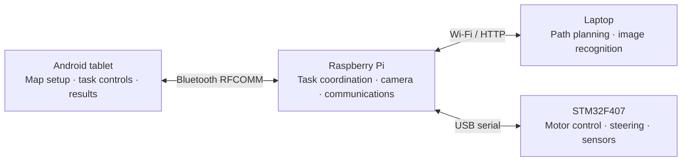

# MDP · Group 24

**Autonomous image recognition and obstacle navigation**

SC2079 Multidisciplinary Project · Nanyang Technological University · AY 2026/27 Semester 1

A robot car that plans routes around an arena, recognises image cards, follows arrow-directed obstacle manoeuvres and returns to its carpark. An Android tablet provides the map and controls; a Raspberry Pi coordinates the laptop services and STM32 motor controller.

[Results](#assessment-results) · [Architecture](#system-architecture) · [Getting started](#getting-started) · [Team](#team) · [Source submission](#source-submission)

## The two challenges

| | Task 1 — Image recognition | Task 2 — Fastest path |
| --- | --- | --- |
| **Objective** | Visit the obstacles and identify their image cards. | Navigate two arrow-marked obstacles and return to the carpark. |
| **Planning** | A* motion search, camera-pose selection and visit ordering on the laptop. | STM32 obstacle manoeuvres followed by a Pi-planned return and parking sequence. |
| **Vision** | A 31-class ONNX symbol-recognition service. | A separate LEFT/RIGHT arrow-recognition service. |
| **Coordination** | The Pi prepares a route, confirms READY to the tablet, then executes after Start. | The Pi supplies camera results and heartbeats while STM32 handles O1/O2. |

The tasks use separate firmware and Pi entry points because different firmware was flashed for each assessment. The Android application is shared.

## Assessment results

| Assessment | Rank | Run time | Recorded result |
| --- | ---: | ---: | --- |
| **Task 1 — rerun** | **13** | **1m 14s** | **6 correct**, 0 incorrect · **60 points** |
| **Task 2** | **10** | **25.6s** | **0 hits**, 0 penalty · **25.6s final score** |

Task 2 preparation time was **1m 07s**. Results are transcribed from the Group 24 entries in the assessment scoreboards supplied by the team.

<details>
<summary>Task 1 assessment note</summary>

The team reports that its first attempt recognised **8/8 images**, but the attempt was disqualified because of Bluetooth connectivity issues at startup. The table above shows the official recorded rerun result; the first attempt is not counted toward that score.

</details>

## System architecture



| Component | Responsibility | Guide |
| --- | --- | --- |
| **Algorithm & vision** | Viewing poses, visit ordering, movement commands and image recognition. | [Algo](Algo/README.md) |
| **Raspberry Pi** | Tablet communication, route execution, camera capture and Task 2 return/parking. | [RPi](RPi/README.md) |
| **STM32** | Motor and steering control, sensors and task-specific movement. | [STM32](STM32/README.md) |
| **Android** | Arena editing, Bluetooth, task controls and result display. | [Android](Android/README.md) |

### Task 1 flow

1. Place the robot and obstacles on the tablet's **20 × 20** arena, then send the map.
2. The Pi requests a route from the laptop. The planner chooses viewing positions and visit order, then returns calibrated movement commands.
3. The Pi queues the route and sends a matching **READY** confirmation. Start releases that prepared route.
4. The robot visits each reachable target. The Pi captures photos, requests recognition and sends the identified image IDs to the tablet.

### Task 2 flow

1. STM32 approaches O1 while the Pi obtains its arrow classification.
2. The firmware carries out the selected O1 bypass and O2 manoeuvres using encoder, heading and range feedback.
3. With `full-pi-return`, the Pi reads the run telemetry and plans the return and carpark entry.
4. The robot returns and completes its parking sequence.

## Repository layout

```text
.
├── Algo/
│   ├── PathPlanning/             # Task 1 planner and movement commands
│   ├── ImageRecognition/
│   │   ├── Task1/                # Symbol recognition API
│   │   └── Task2/                # Arrow recognition API
│   └── Services/                 # Laptop setup, launchers and test fixtures
├── Android/                      # Shared tablet application and Gradle project
├── RPi/
│   ├── Task1/                    # Route preparation, execution and recognition
│   └── Task2/                    # Camera bridge and return/parking controller
├── STM32/
│   ├── Task1/                    # Task 1 STM32CubeIDE project
│   └── Task2/                    # Task 2 STM32CubeIDE project
├── build_submission.py           # Source-only TXT archive generator
└── README.md
```

`main` contains the final selected implementations. Build files, Android resources and firmware libraries remain in the repository so the projects can be rebuilt. Model weights, environments, captures and build output are excluded from Git.

## Getting started

| Step | Action |
| --- | --- |
| **1. Laptop** | Set up Python and obtain the task's recognition model. See [Algo setup](Algo/README.md#setup). |
| **2. Firmware** | Build and flash the matching task project. See [STM32 setup](STM32/README.md#build-and-flash). |
| **3. Raspberry Pi** | Deploy the matching Pi directory and set the laptop address. See [Pi startup](RPi/README.md#run-task-1). |
| **4. Tablet** | Build the app, pair with the Pi and configure the arena. See [Android setup](Android/README.md#build-and-install). |

For Task 1, start the laptop services from the repository root:

```powershell
.\Algo\.venv-cv-win\Scripts\python.exe Algo/Services/laptop_start.py --python .\Algo\.venv-cv-win\Scripts\python.exe
```

For Task 2, start its separate arrow service and, from the deployed Pi Task 2 directory, use:

```bash
python3 KC_task2_stm32_bridge.py --execute --stage full-pi-return --port /dev/ttyACM0 --laptop-ip <laptop-wifi-ip>
```

The laptop and Pi must be reachable on the same network. Both recognition services normally use port **8001**, so start the service for the selected task. Only one Pi controller should own the serial port or camera at a time.

## Team

| Crew | Component | Members |
| --- | --- | --- |
| **Shipwrights** | STM32 | Ethan Loh Wenxi<br>Tan Kia Chun (Chen Jiajun)<br>Murugesan Nuvaan |
| **Cartographer** | Android | Jacob Ong Jia Chun |
| **Captains** | Raspberry Pi | Tan Jou Yuan (Chen Jouyuan)<br>Matz Chan |
| **Navigators** | Algorithm | Jacob Loh Jun Cong<br>Baskar Kayalvizhi Athithiya |

## Validation

The repository includes planner regressions, mock-based Pi/controller tests, recognition API tests, Android unit tests and portable C firmware simulations. Commands and their scope are documented in the component guides.

The cleaned implementation was checked with an Android debug build and unit tests, the Python offline suites, **144 Pi-return simulations**, three portable C suites and nominal left/right fast-O1 simulations. These checks complement the assessment results; they do not establish clearance under every physical configuration. The [firmware guide](STM32/README.md#calibration-and-test-limits) records the wider stress-test limitations.

## Source submission

From the repository root:

```bash
python build_submission.py
```

This creates one file:

```text
output/MDP_2026-27S1-TEAM-24_Source_Code.zip
```

The archive keeps the four component folders and task-specific source. Every source file is renamed to **`original.extension.txt`** and is accompanied by a README and SHA-256 manifest. Configurations, resources, libraries, generated support code, trained weights and binaries are excluded in accordance with the source-code submission instructions. `output` is local and ignored by Git.

External model attribution and existing component licence notices are retained. Model sources and checkpoint checksums are listed in the [Algo guide](Algo/README.md#recognition-models).
